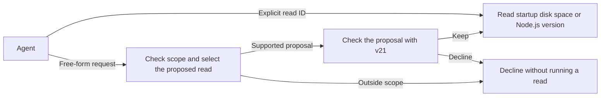

# Cuqe

When an agent asks how much space is left on your Mac or which Node.js version is installed, Cuqe answers with a fixed read-only action. If the agent passes the request in plain English, a small local model checks that the proposed read matches before Cuqe runs it.

## Choose how to run Cuqe

| What you want | Setup |
| --- | --- |
| Check this Mac from Terminal or Codex | [Install locally](#install-on-an-apple-silicon-mac). The two built-in reads need no account, server URL, or model. |
| Read a Mac from another device on your tailnet | [Use the private Tailscale MCP](#try-the-private-tailscale-mcp). This path serves the disk read. |
| Read your Mac from ChatGPT | [Deploy your own private Cuqe Site](hosted/README.md). This path uses your ChatGPT sign-in and serves both reads. |

## Install on an Apple silicon Mac

Download `cuqe-v0.4-beta-macos-arm64.tar.gz` and `SHA256SUMS` from the [v0.4 beta release](https://github.com/k0nkupa369/Cuqe/releases/tag/v0.4-beta). In the download directory, verify and extract the archive.

```sh
shasum -a 256 -c SHA256SUMS
tar -xzf cuqe-v0.4-beta-macos-arm64.tar.gz
cd cuqe-v0.4-beta-macos-arm64
./cuqe --version
```

The binary is a beta build. If macOS blocks it, build from the tagged source with Rust 1.92 or later and the Xcode command-line tools.

```sh
git clone --branch v0.4-beta https://github.com/k0nkupa369/Cuqe.git
cd Cuqe
cargo build --release --locked
./target/release/cuqe --version
```

## Read disk space and Node.js

Run these in the extracted directory. For a source build, use `./target/release/cuqe` in place of `./cuqe`.

```sh
./cuqe --read disk_space
./cuqe --onboard-node
./cuqe --read node_version
```

Activate your preferred Node.js installation in the terminal before onboarding. Cuqe resolves the first executable `node` on your shell's `PATH`, probes its version, and saves the resolved path in `~/Library/Application Support/Cuqe/node.json`. Subsequent reads use that executable and report its version, path, scope, and observation time. Refresh onboarding if a package-manager upgrade removes the saved binary. Before onboarding, Cuqe uses its own process's `PATH`. Set `CUQE_CONFIG_DIR` to use a separate profile.

## Use Cuqe from Codex

Install [uv](https://docs.astral.sh/uv/) and open a terminal in the extracted package or source checkout. Register the local MCP server in Codex.

```sh
codex mcp add cuqe -- "$(command -v uv)" run --python 3.12 --with mcp==1.30.0 "$PWD/scripts/cuqe_mcp.py"
codex mcp get cuqe
```

In a new Codex session, ask “Use Cuqe to check free space on my startup disk” or “Use Cuqe to check my installed Node.js version.” The `cuqe.read_machine` tool accepts only `disk_space` and `node_version`. It runs the corresponding read on this Mac. If you use a separate profile, pass `--env CUQE_CONFIG_DIR=/absolute/path` before the `--` in the registration command. Keep the Cuqe directory in the same location after registration. To move it, run `codex mcp remove cuqe` and register it again from the new directory.

## Optional free-form verification

Use a local Ollama instance that returns decision token log probabilities. Keep it on loopback. Get the GGUF and its checksum file from the [v0.1 beta model release](https://github.com/k0nkupa369/Cuqe/releases/tag/v0.1-beta). Place the GGUF and its checksum file next to the supplied Modelfile, then run the following commands.

```sh
shasum -a 256 -c SHA256SUMS
ollama pull qwen3:0.6b
ollama create cuqe-verifier:v0.1-beta -f Modelfile
./cuqe --verified "How much free space is on my startup disk?"
./cuqe --verified-node "What is the installed Node.js version?"
```

Set `CUQE_OLLAMA_PORT` to use a different local port. The optional MCP tools `cuqe.disk_space` and `cuqe.node_version` take the original request and use this path. See the [changelog](CHANGELOG.md) for release history.

## Agent skill

The [Cuqe skill](.agents/skills/cuqe/SKILL.md) tells agents which tools to use for supported Mac reads. Codex discovers it from this checkout.

## Try the private Tailscale MCP

Use this pilot from a source checkout with a release binary built locally. It serves one read-only tool, `read_startup_disk`, to a client that runs on your tailnet.

On the Mac, use a dedicated Serve port allowed by your tailnet policy for the people who should use Cuqe. Use Tailscale Serve for HTTPS. In the first terminal, start the adapter with the exact authority of the Serve URL and the login of the person who can read this Mac.

```sh
uv run --python 3.12 --with mcp==1.30.0 scripts/cuqe_tailnet.py \
  --serve-host my-mac.my-tailnet.ts.net:8443 \
  --allow-login you@example.com
```

In a second terminal on the Mac, start Serve in the foreground.

```sh
tailscale serve --https=8443 http://127.0.0.1:9476
```

On another device on the tailnet, register the MCP URL with your local Codex client.

```sh
codex mcp add cuqe-tailnet --url https://my-mac.my-tailnet.ts.net:8443/mcp
```

Ask Codex to read startup disk space on the connected Mac. Repeat `--allow-login` for another approved Tailscale user. The adapter requires Serve's user identity, so connections from tagged devices without user identity are denied. The loopback listener trusts processes on the Mac. To revoke a user, remove their `--allow-login` entry and restart the adapter. Remove any tailnet rules that also allow the revoked access. If the Mac goes offline or you stop the adapter or Serve, the client receives a connection error and cannot read fresh disk data. [Tailscale Serve](https://tailscale.com/docs/features/tailscale-serve)

From a second device, you can run `python3 scripts/probe_cuqe_tailnet.py <mcp-url> --disk-result '<local-cli-output>'` to compare with the Mac’s CLI. Repeat with `--denied` after revoking that login.

## Use Cuqe from ChatGPT privately

The [private ChatGPT setup guide](hosted/README.md) shows how to deploy your own Sites plugin and pair your Mac. Use the pairing page and relay URLs from your own deployment. A GitHub download enables the local CLI and MCP. The private ChatGPT plugin is created when you publish your own Site.

## Verifier and archived results



```console
$ ./cuqe --read disk_space
31.6% free (292.8 GiB available of 926.4 GiB total) on /System/Volumes/Data
$ ./cuqe --read node_version
{"version":"v22.23.1","executable":"~/…/bin/node","resolution_scope":"saved_profile","observed_at_unix_ms":1795331130161}
$ ./cuqe --verified "How much space is left on this Mac?"
cuqe: Cuqe verifier declined the disk space request
```

These are results from a Mac with Node.js already onboarded and both local models installed. The Node.js example abbreviates the executable path.

## How it decides

An explicit read ID goes straight to the built-in read. In free-form mode, stock Qwen3 0.6B checks which read the user asked for. The Qwen3 0.6B v21 verifier then scores that proposal. Cuqe subtracts the decline token's log probability from the accept token's log probability. It keeps the proposal only if both scores are present and the finite margin is at least `2.2131806164979935`. The [calibration run](eval/README.md) selected the highest cutoff that retained at least 90% of correct stock proposals.

## Development results

| v21 development measure | Result |
| --- | ---: |
| Correct action offered and kept | 39/48 |
| Correct action absent and declined | 44/48 |
| Both presentations correct | 35/48 |
| Correct stock proposals kept in calibration | 38/42 |
| Archived wrong proposals declined | 22/25 |
| Warm p95, ranking and verification | 365 ms over 96 presentations |
| Peak Ollama-reported resident size, both models | 1.08 GiB |

Run `python3 eval/report.py` to regenerate this table from the [archived observations](eval/README.md). These were simulated catalogs on an Apple M4, with actions beyond the two shipped reads. See the [model card](MODEL_CARD.md) for details.

## Known misses and limits

- Valid requests can be declined, as in the disk-space example above. When the caller already knows the exact read, it can pass its ID.
- In the simulated release smoke check, the verifier accepted minimizing a window for a request to close it. The [model card](MODEL_CARD.md) records the case.
- Cuqe runs on Apple silicon macOS and supports two reads. The beta binary is ad hoc signed and carries no Apple Developer ID signature.

## Running the checks

Run the Rust checks on an Apple silicon Mac. Install the Python test dependencies in a virtual environment with Python 3.10 or 3.12.

```sh
cargo fmt --check
cargo clippy --locked --all-targets -- -D warnings
cargo test --locked
python -m pip install --require-hashes -r requirements-dev.txt
python -m pytest -q
```

The checks use test fixtures for model responses and need no GGUF or Ollama service.
